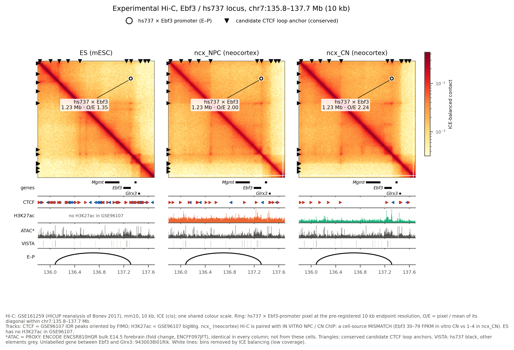
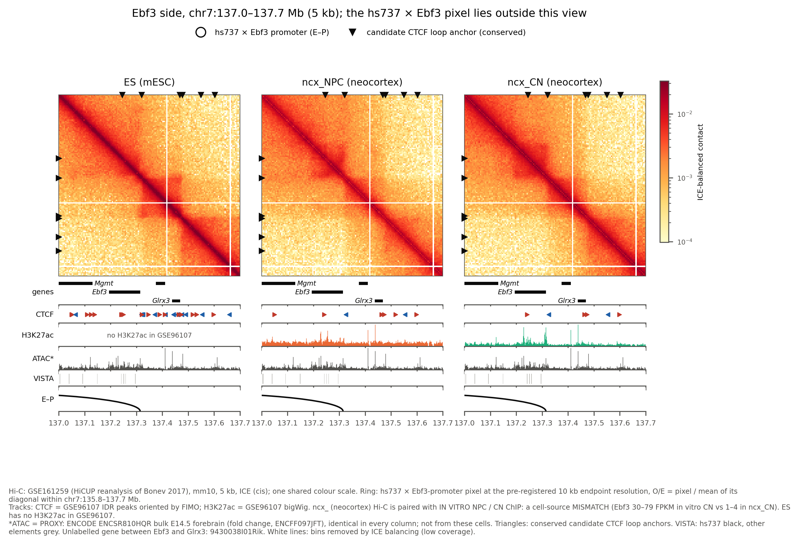
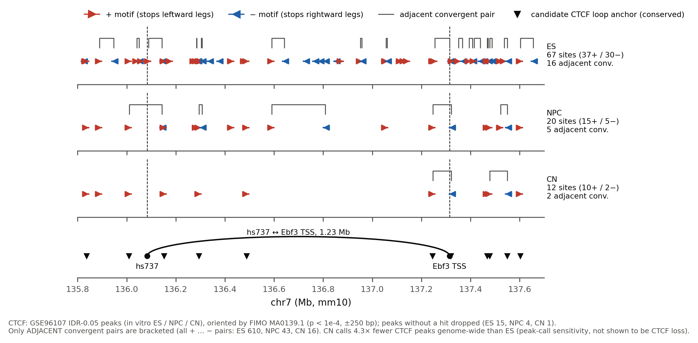
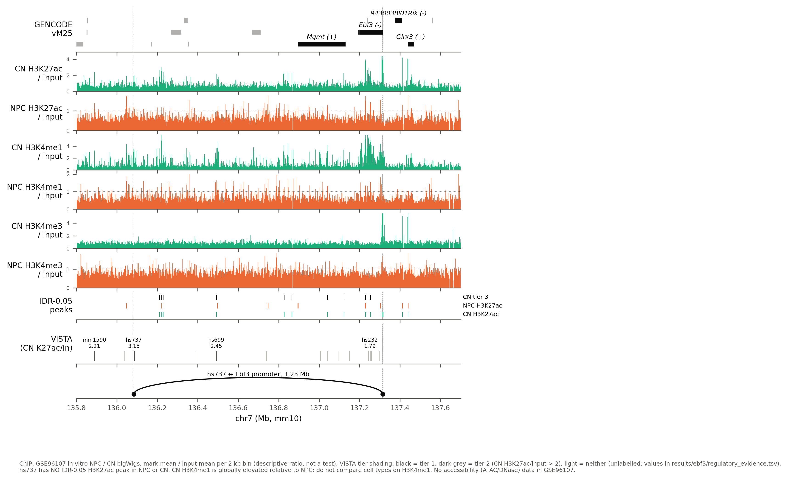

# Question

VISTA enhancer **hs737** (chr7:136,083,204–136,084,349; mouse ortholog Rr169617,
whose knockout lowers Ebf3 ~20 %) lies **1.23 Mb** from the **Ebf3 promoter**
(TSS chr7:137,314,445, minus strand). Does cohesin loop extrusion with CTCF
barriers reproduce their contact frequency, or does an attractive
enhancer–promoter (E–P) interaction have to be added?

Statements are labelled as **observation** (measured), **prediction** (model
output), or **hypothesis**. A better fit from adding E–P attraction shows the
attraction is *sufficient* in the model, not that it is *necessary* in cells.
Hi-C is a population average; every result is an ensemble contact frequency.

# Data and their limits

| Data | Source | Cells | Role |
|---|---|---|---|
| Hi-C | GEO GSE161259 (HiCUP reanalysis of Bonev 2017) | ES; **neocortex-sorted** NPC, CN (`ncx_`) | experiment |
| CTCF, H3K27ac, H3K4me1/3, Input | GEO GSE96107 (Bonev 2017) | ES; **in vitro** NPC, CN | barriers, enhancer evidence |
| ATAC-seq | ENCODE ENCSR810HQR | bulk E14.5 forebrain | **proxy** for accessibility |
| Enhancers | VISTA (UCSC mm10) | — | annotation |

**Cell-source mismatch.** The Hi-C for NPC / CN is from neocortex, but the
ChIP is from in vitro cultures. Ebf3 is 30–79 FPKM in in vitro CN and only
1–4 FPKM in neocortex CN. Matched in vitro Hi-C must be reprocessed from SRA
(87 runs, ~786 GB; scoped, awaiting approval). Until then, every comparison of
the models (built on in vitro CN CTCF) with ncx_CN Hi-C carries this mismatch.

# Region

Simulated and displayed window: **chr7:135,800,000–137,700,000** (1.9 Mb,
1,900 × 1 kb monomers): 283 kb left of hs737, 386 kb right of the Ebf3 TSS,
enclosing the conserved CTCF clusters on both sides. The E–P contact is
measured at **10 kb**, the finest resolution with ≥ 30 reads in the E–P pixel
in every state (rule fixed before any data were looked at). The left edge sits
20–80 kb from a strong insulation boundary just outside the window
(docs/ebf3/01_hic_qc.md).

# Experimental Hi-C (observation)

{width=100%}

{width=90%}

E–P observed/expected at 10 kb (expected = mean of the same diagonal inside the
window), with the two random halves of each dataset:

| State | O/E | half A | half B |
|---|---|---|---|
| ES | 1.35 | 1.42 | 1.27 |
| ncx_NPC | 2.00 | 2.06 | 1.96 |
| ncx_CN | 2.24 | 2.10 | 2.38 |

**Observation.** The hs737 × Ebf3 contact is enriched over distance-matched
background in both neural states (2.0–2.2×) and less in ES (1.35×), a larger
difference than between halves of one dataset. The strongest dot in the same
column is not at hs737 but at the CTCF pair 136,489(+) × 137,321(−).

# CTCF barriers

{width=100%}

FIMO (MA0139.1, p < 1e-4) oriented ES 67, NPC 20
and CN 12 sites in the window. In CN, a − site 7 kb from the Ebf3
TSS and + sites flanking hs737 form convergent pairs that nearly bracket the E–P
pair, so extrusion alone may raise contacts near the E–P pixel. CN calls 4.3×
fewer CTCF peaks genome-wide than ES, most likely a peak-calling difference.

# Enhancer evidence

{width=100%}

| element | tier | CN K27ac/in | CN K4me1/in | ATAC peak FE* | ATAC max FC* |
|---|---|---|---|---|---|
| mm1590 | 2 | 2.21 | 3.14 | – | 3.71 |
| mm2007 | - | 1.19 | 1.27 | – | 0.98 |
| hs737 | 1,2 | 3.15 | 3.73 | 9.89 | 11.17 |
| mm1574 | - | 0.66 | 1.07 | – | 0.98 |
| hs699 | 2 | 2.45 | 4.45 | – | 6.44 |
| hs562 | - | 1.46 | 2.63 | – | 1.27 |
| hs656 | - | 1.06 | 3.08 | – | 2.64 |
| hs696 | - | 1.08 | 2.63 | – | 1.86 |
| hs331 | - | 1.62 | 4.03 | – | 1.17 |
| hs589 | - | 1.63 | 2.78 | – | 1.86 |
| hs2776 | - | 1.10 | 2.95 | – | 1.56 |
| hs2775 | - | 1.18 | 3.92 | – | 1.56 |
| hs232 | - | 1.79 | 5.52 | 5.52 | 6.10 |
| hs2593 | - | 0.95 | 2.66 | – | 1.72 |
| hs2774 | - | 0.89 | 3.31 | – | 1.27 |
| Ebf3_promoter | promoter | 7.50 | 1.75 | 7.10 | 7.74 |

\* ATAC = **proxy** (bulk E14.5 forebrain, not these cells). hs737 has no
H3K27ac IDR peak in NPC or CN but has the strongest ATAC peak among VISTA
elements in the window (fold 9.9) and the highest CN H3K27ac/input ratio.

# Models

All share one polymer, one window, identical sampling (3 replicates × 10,000
frames × 28 tiled copies) and CN (in vitro) CTCF.

| Model | Cohesin + CTCF | E–P attraction | Force | Compare with |
|---|---|---|---|---|
| A | no | no | default | B |
| A0 | no | no | attractive, 0 kT | C, D |
| B | yes | no | default | A |
| C | no | 3 kT | attractive | A0 |
| D | yes | 3 kT | attractive | A0 |

Cohesin: lifetime 75,000, separation 240, CTCF capture 0.5 (polysim defaults,
not fitted). E–P attraction acts only between hs737 and the Ebf3 promoter.

# Simulations vs experiment (prediction)

*Pending: the production simulations are running. This section fills in when `scripts/ebf3/plot_model_panels.py` has run.*

# What can and cannot be concluded

- If B reaches the experimental E–P O/E, extrusion with CTCF is **sufficient** in
  this model; it does not exclude an E–P attraction in cells.
- If only C or D reaches it, an E–P attraction is **sufficient** in the model to
  reproduce the measurement; it is not shown to be **necessary**, nor unique.
- Different parameter sets can give indistinguishable maps; the sensitivity
  sweeps (cohesin lifetime / density / capture, attraction energy, enhancer set)
  are needed before quoting a range.
- The neural Hi-C is neocortex; the model's CTCF and enhancer evidence are in
  vitro. Matched in vitro Hi-C is the decisive comparison.

# Open decisions

1. Tier-2 enhancer set: rule-computed (mm1590, hs737, hs699) vs listed (hs737,
   hs699, hs232). ATAC supports hs232 (peak, FE 5.5) over mm1590 (no peak).
2. Reprocess in vitro NPC / CN Hi-C from SRA (~786 GB, 1–2 days).
3. Left window edge: keep, or move to 135,700,000 to enclose the nearby boundary.
4. Sensitivity sweeps (cost: 12 GPU jobs per added condition).

*Sources, scripts and full methods: docs/ebf3/00–04, branch `ebf3-locus`.*
