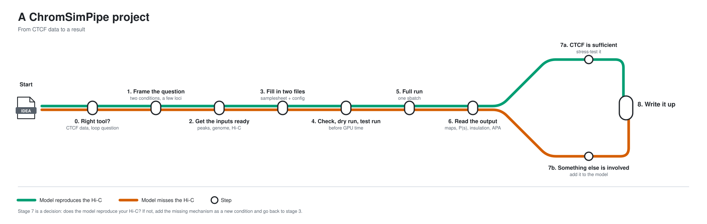

# Journey Map: From Your Data to a Result {#sec-journey}

This page is for someone who has **ChIP-seq, CUT&Tag or CUT&RUN data** and
wants to know what ChromSimPipe could do with it, and what they would have to
do, in order, to get there. It shows the whole route first and the details
after. Each stage ends with a pointer to the page that covers it in depth;
the [Vignette](vignette.qmd) is the same route told with the shipped
HEK293T example.

::: {.callout-note appearance="simple"}
You do not need to know polymer physics or have used Snakemake. You do need
to be comfortable on a Linux cluster with a GPU queue, and to have the
files described in Stage 2.
:::

## The route at a glance

{#fig-journey .lightbox fig-alt="Subway map of a ChromSimPipe project. A shared line runs through stages 0 to 6: right tool, frame the question, get the inputs ready, fill in two files, check with a dry run and test run, full run, read the output. It then splits: a green line for when the model reproduces the Hi-C (7a, CTCF is sufficient, stress-test it) and an orange line for when it misses (7b, something else is involved, add it to the model). Both end at stage 8, write it up."}

Stage 7 is the fork: the green line is the route when the model reproduces
your Hi-C, the orange one when it doesn't. When it doesn't, you add the
missing mechanism as a new condition and go back to Stage 3, as the footnote
says (the map draws connections left to right only, so that loop is not
drawn as a line).

Most of the effort is in Stages 2 and 3, and most mistakes are caught in
Stage 4. The simulation itself (Stage 5) needs no attention once it starts.

## Stage 0: Is ChromSimPipe the right tool?

ChromSimPipe asks one question:

> **Are the CTCF sites, as measured, enough to explain the loops in the
> Hi-C?**

It builds a physical model in which the only thing that differs between two
simulations is the set of CTCF sites (or one other setting you choose), and
compares the simulated contact maps to Hi-C. Hi-C is never an input to the
simulation; it is only the thing the result is judged against.

| You have... | Good fit? | Notes |
|---|---|---|
| CTCF ChIP / CUT&Tag / CUT&RUN in two states, plus Hi-C in both | **Yes: the intended use** | A treatment, genotype, cell type, time point, degron... |
| CTCF data in one state, plus Hi-C | Yes | "Can CTCF alone reproduce this map?" The control state is the baseline |
| CTCF data in two states, no Hi-C | Yes, as a prediction | You get simulated maps without the comparison. See [Simulating without Hi-C](recipes.qmd#simulating-without-hi-c) |
| Hi-C only | Not by itself | The model needs CTCF positions to place its barriers |
| Cohesin (RAD21, SMC1), NIPBL, YY1, LDB1... data too | Yes, as extras | These can set where cohesin loads or pauses, or which beads attract: [recipes](recipes.qmd) |
| Histone marks, ATAC-seq only | No | Not something the model uses directly |
| A whole-genome question | No | The model simulates windows of about 1–2 Mb, one locus at a time |

## Stage 1: Frame the question

Before touching a file, write down, in one sentence each:

1. **The two conditions** you are comparing (for example control vs. treated,
   wild type vs. knockout).
2. **The loci** you care about: a few places where the Hi-C changes, or
   where it doesn't but you expect it to. Two to four is typical. Each
   becomes a window of about 1–2 Mb.
3. **What would count as an answer.** "The simulated loop weakens like the
   real one" supports CTCF as sufficient. "It stays put and the real one
   weakens" says something else is going on.

Add a **positive control** if you can, a locus where you are confident CTCF
shapes the loops, so a miss at your own loci is more convincing.

*More:* [What question does ChromSimPipe answer?](vignette.qmd#what-question-does-chromsimpipe-answer)

## Stage 2: Get the inputs ready

You need three kinds of file. Most labs already have the first two.

### Peaks: from reads to a peak file

ChromSimPipe takes **peaks**, not reads. If you have only FASTQ or BAM files,
the upstream steps below happen outside this pipeline.

| Step | What to do | Watch out for |
|---|---|---|
| Align | Align reads to the genome you will simulate on | Use the same assembly as your Hi-C (for example hg38 or mm10) |
| Call peaks | A peak caller that writes **narrowPeak**, such as MACS2/MACS3, is the simplest option | The pipeline reads the **summit** (narrowPeak column 10) and the **signal** (column 7). A plain BED works, but its sites are centred on the peak midpoint, which is less precise |
| Replicates | Give the pipeline **one peak file per condition**: pool the replicates' reads, or keep peaks found in both | One condition = one row = one file |
| Controls | Call peaks against your IgG / input control as your assay normally does | Use the same settings for both conditions |

::: {.callout-tip}
### CUT&Tag and CUT&RUN

These assays often use SEACR instead of MACS. SEACR writes a BED with no
summit column, and its regions can be wide, so the midpoint may sit far from
the motif. If you can, also call peaks with a caller that writes narrowPeak
summits (MACS2/MACS3 work on CUT&Tag/CUT&RUN fragments) and use that file
here. Either way, the next step shows you what the pipeline did with your
peaks.
:::

**What the pipeline does with your peaks.** It looks for the CTCF motif within
±250 bp of each summit and keeps the peaks that have one, recording the
motif's direction. Direction matters because cohesin stalls at CTCF only when
it arrives from the correct side, so a loop forms between *convergent* sites.
**Peaks without a motif are dropped**, so a peak can be "lost" from the model
simply because it has no CTCF motif under it.

### Genome

A FASTA of the genome you aligned to. Point `genome:` in the config at it;
the index is built on first use.

### Hi-C (optional but central)

A `.hic`, `.mcool` or `.cool` map per condition, ideally merged across
replicates. An `.mcool` must contain 1 kb bins (the default resolution). If
you have no Hi-C for a condition, write `NA` and you get simulations without
the comparison.

### The one rule for all three

**Peaks, genome and Hi-C must all be on the same assembly, with the same
chromosome names** (`chr7`, not `7`). A mismatch does not crash anything: the
motif search reads the wrong DNA, or a Hi-C window comes back empty. Stage 4
catches it.

*More:* [Setup](setup.qmd), [`data/README`](https://github.com/jpflores-13/ChromSimPipe/blob/main/data/README.md)

## Stage 3: Fill in two files

Everything you decide goes into two small text files.

**`ChromSimSamplesheet.txt`: one row per sample, tab-separated.**

```
Project   Cell_Type  Condition  CTCF_Peaks                         Hi-C
MyProj    K562       control    /proj/lab/ctcf/control.narrowPeak  /proj/lab/hic/control.mcool
MyProj    K562       treated    /proj/lab/ctcf/treated.narrowPeak  /proj/lab/hic/treated.mcool
```

Only `CTCF_Peaks` and `Hi-C` are fixed names; add any other columns you
like. Use full paths, or links in `data/`. Use `NA` where a file doesn't
exist. Tabs, not spaces.

**`config/ChromSimConfig.yaml`: three parts to edit.**

1. `genome:` and `genome_assembly:` point at your FASTA.
2. `loci:` gives each window a name, chromosome, start and end. Centre it on
   your loop, about 1–2 Mb wide, with coordinates on the 1 kb grid.
3. `conditions:` lists the simulations to run. The simplest useful pair
   differs *only* in whose CTCF it uses:

   ```yaml
   conditions:
     - name:         control_baseline
       params_name:  control
       lifetime:     75000
       separation:   240
       ctcf_capture: 0.5
       ctcf_type:    control
       compare_hic:  control
     - name:         treated_ctcf-only
       params_name:  treated
       lifetime:     75000
       separation:   240
       ctcf_capture: 0.5
       ctcf_type:    treated
       compare_hic:  treated
   ```

   `ctcf_type` names the sample whose CTCF sites are used; `compare_hic`
   names the Hi-C to judge it against. The cohesin settings are the same in
   both, so any difference is due to CTCF.

Unsure what the other settings do? Leave the defaults. They are published
values, and you can come back to them in Stage 7.

*More:* [Samplesheet](vignette.qmd#the-samplesheet),
[Config, section by section](vignette.qmd#the-config-section-by-section),
[Configuration reference](configuration.qmd)

## Stage 4: Check before you spend GPU time

Three checks, in this order, from cheapest up. Each stops a different kind of mistake
before any GPU job runs.

```bash
bash check_inputs.sh        # names, assemblies, Hi-C resolution, peaks per window
bash ChromSimPipe.sh -n     # dry run: lists every job, catches missing files
sbatch ChromSimPipe.sh --configfile config/ChromSimConfig.test.yaml   # test run, one GPU job
```

Then run the **test config** (a single GPU job for one locus) to see that the
whole chain works on your cluster, and to measure how long a job really
takes there.

| If you see... | It usually means |
|---|---|
| `FAIL` about chromosome names | Peaks or Hi-C use `7`, the genome uses `chr7` (or the reverse) |
| `FAIL` about chromosome lengths | Hi-C or peaks are on a different assembly from the genome |
| `WARN`: no peaks in a window | The window is in the wrong place, or the peaks are from another assembly |
| `MissingInputException` | A path in the samplesheet or the genome path is wrong |

*More:* [Running](running.qmd), [Check names and assemblies](vignette.qmd#check-names-and-assemblies-before-you-run)

## Stage 5: The full run

```bash
sbatch ChromSimPipe.sh
```

Then wait. The number of GPU jobs is loci × conditions × replicates × shards;
for two loci and two conditions with the defaults that is 24. Do not edit the
config while the run is going. If it crashes, `bash unlock.sh` and submit
again: finished work is kept.

*More:* [Running the pipeline](vignette.qmd#running-the-pipeline), [Cluster](cluster.qmd)

## Stage 6: Read the output

Results are in `output/loci/<locus>/analysis/<condition>/`. In the order
most people look:

| Look at | It answers |
|---|---|
| The simulated contact map next to the Hi-C map | Do the same loops, stripes and domains appear? |
| Condition vs. condition (treated minus control) | Does the *change* in the simulation match the change in the Hi-C? This is the key comparison |
| P(s), the contact decay curve | Is the overall extrusion level plausible? ([P(s) page](ps.qmd)) |
| Insulation and APA (aggregate loop signal) | Are domain boundaries and loops quantitatively similar? |
| The oriented CTCF sites at your loop anchors | Is there a convergent pair under a missing loop, or only one motif, or none? |

Two things to keep in mind when reading:

- The model **over-predicts loops** by default, since every convergent pair
  makes one. Judge the *change* between conditions, not just whether a loop
  is present.
- Simulated contacts decay faster with distance than in Hi-C, so compare
  observed/expected maps or within-simulation changes, not raw values.

*More:* [Reading the outputs](vignette.qmd#reading-the-outputs), [Analysis](analysis.qmd)

## Stage 7: Interpret, then decide what's next

**7a. The model reproduces the change.** CTCF binding alone is enough to
explain it. Before you trust that, check it isn't a quirk of one parameter
choice: repeat over a few cohesin lifetimes
([a robustness range](recipes.qmd#a-robustness-range)) or run a quick 1D
screen first ([recipe](recipes.qmd#a-1d-screen-before-3d-runs)).

**7b. The model does not.** That is a result: *the CTCF change, as the model
represents it, is not sufficient.* To say what else might be involved, add
it as a new condition and see whether it closes the gap:

| Suspect | Recipe |
|---|---|
| CTCF sites differ in strength, not just presence | [CTCF strength from peak signal](recipes.qmd#ctcf-strength-from-peak-signal) |
| Cohesin lifetime or amount changed | [WAPL loss](recipes.qmd#cohesin-stays-longer-wapl-loss), [NIPBL/RAD21 depletion](recipes.qmd#fewer-cohesins-nipbl-or-rad21-depletion) |
| Another factor holds loops (YY1, LDB1...) | [Sticky sites](recipes.qmd#other-factors-sticky-sites) |
| Cohesin loads or pauses in particular places | [Where cohesin loads](recipes.qmd#where-cohesin-loads), [pauses](recipes.qmd#where-cohesin-slows-down) |
| Chromatin state changed | [Compaction](recipes.qmd#chromatin-compaction) |

Each new condition is a few lines in the config, then back to Stage 4. Existing
results are kept, so only the new condition runs.

## Stage 8: Write it up

Report what was held fixed and what varied, the loci and window sizes, and
how many replicates were pooled. Cite the model and software
([References](references.qmd)), and state the model's limits as part of the
conclusion: equal-strength sites by default, no compartments unless you add
sticky factors, and borrowed rather than fitted parameters.

## A checklist to print

- [ ] Two conditions and a few loci chosen, plus a positive control if possible
- [ ] One peak file per condition (narrowPeak preferred), same assembly as the genome
- [ ] Hi-C per condition, or `NA`
- [ ] Genome FASTA available
- [ ] Samplesheet filled in with tabs
- [ ] Config: genome, loci, conditions
- [ ] `bash check_inputs.sh`: no `FAIL`
- [ ] `bash ChromSimPipe.sh -n` and the test config pass
- [ ] `sbatch ChromSimPipe.sh`
- [ ] Output read, condition-to-condition comparison first
- [ ] Robustness checked before concluding
