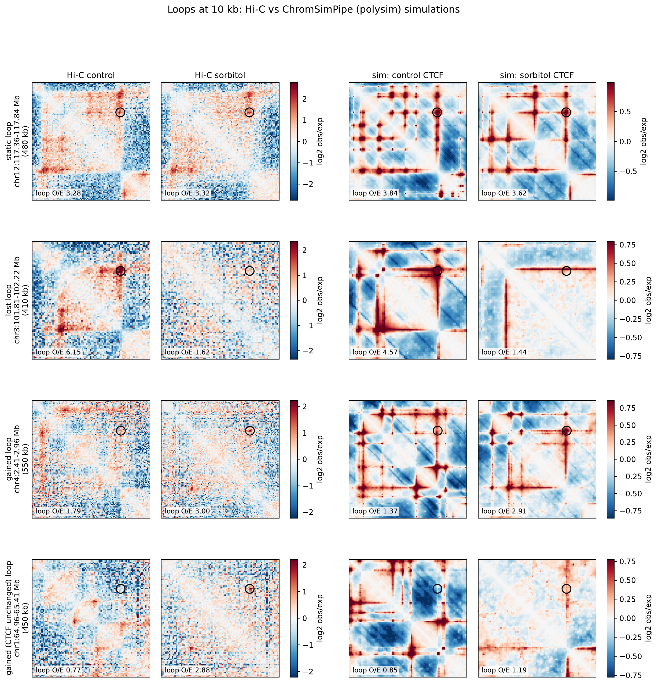
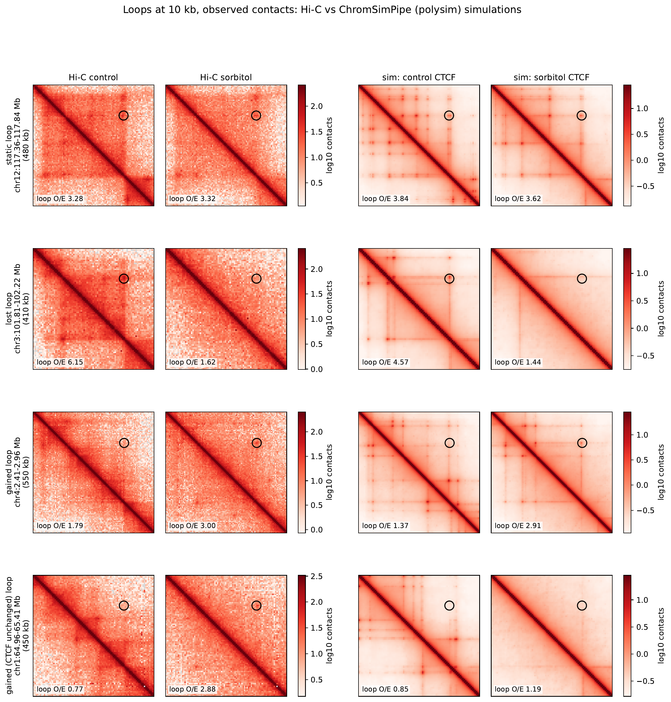

::: {.callout-tip appearance="simple"}
### Quick start

If someone has already set up ChromSimPipe on your cluster and you just want
a run, these are the six steps. Each one is explained in the sections below.

1. Clone the repository and `cd` into it ([Setup](#one-time-setup)).
2. Point the samplesheet at your input files: full paths, or links in
   `data/` checked with `ls -lL data/`
   ([Linking the input files](#link-the-input-files-into-data)).
3. Set `CHROMSIM_PROFILE` and `CHROMSIM_OUTPUT_ROOT` in `~/.bashrc`
   ([Per-cluster settings](#tell-chromsimpipe-which-cluster-you-are-on)).
4. Check that the inputs agree with each other: `bash check_inputs.sh`
   ([Checking the inputs](#check-names-and-assemblies-before-you-run)).
5. Dry run, then the one-GPU test config:
   `bash ChromSimPipe.sh -n`, then
   `sbatch ChromSimPipe.sh --configfile config/ChromSimConfig.test.yaml`
   ([Running](#running-the-pipeline)).
6. Full run: `sbatch ChromSimPipe.sh`, then read
   `output/loci/<locus>/analysis/<condition>/` ([Outputs](#reading-the-outputs)).
:::

This page is a single narrative walkthrough. The other chapters of this site
are reference pages (every option, every rule); this one takes a new lab
member from an empty home directory to a finished run and a figure, in the
order you would actually do things. Where a value is set in the config or
the samplesheet, the text says where, so you can change it there rather than
in the code.

## What question does ChromSimPipe answer?

Suppose you treat cells with something (here, 1 h of sorbitol, a
hyperosmotic stress) and see two things change:

1. **CTCF binding** changes: some CTCF peaks disappear, some appear
   (measured by CUT&Tag or ChIP-seq).
2. **The Hi-C map** changes: some loops (the "dots" off the diagonal) get
   weaker, some get stronger.

The obvious hypothesis is that (1) causes (2). ChromSimPipe tests that
hypothesis directly:

> **Is the change in CTCF binding, on its own, enough to explain the change
> in Hi-C?**

It does this by building a physical model of chromatin in which the *only*
thing that differs between the two simulations is the set of CTCF sites. If
the simulated maps change the way the real Hi-C maps change, CTCF is a
sufficient explanation. If they don't, something else (cohesin itself,
another protein, transcription, compartments) has to be involved.

::: {.callout-important}
### Hi-C is never an input to the simulation

The simulation only sees CTCF sites and a handful of physical parameters.
Hi-C is used **afterwards**, to judge the simulation. This is what makes the
comparison a fair test: the model cannot "learn" the answer from the data it
is compared against.
:::

### The model in plain language

The model is **loop extrusion** (Fudenberg et al. 2016):

- **Cohesin** is a ring that lands on DNA and reels it in from both sides,
  so a loop grows between its two "legs".
- **CTCF** is a roadblock with a direction. CTCF binds a short DNA motif,
  and the motif's orientation (+ or −) decides which side it blocks: a +
  site stops a cohesin leg coming from the right (moving leftward), a −
  site stops one coming from the left (moving rightward).
- When the two legs are stopped by a **convergent pair** (a + site on the
  left, a − site on the right, pointing at each other), the loop is held
  between those two sites. Across millions of cells this shows up in Hi-C
  as a **dot** at the two anchors.
- Cohesin eventually falls off (its **lifetime**) and lands somewhere else.
  How often it lands is set by the **separation** between cohesins, and how
  often a CTCF site stops a passing leg is the **capture** probability.
- Real CTCF sites are not equally strong: a site bound in most cells stops
  cohesin far more often than one bound in a few. ChromSimPipe can give each
  site its own capture probability from its **CTCF occupancy**, read from the
  CTCF ChIP-seq signal (see [Per-site CTCF strength](#per-site-ctcf-strength-from-occupancy)).

Remove one site of a convergent pair and cohesin slides past it: the loop
no longer has a fixed end, and the dot fades. Add a site that completes a
convergent pair and a new dot can appear.

```{=html}
<figure style="margin: 1.5rem 0;">
<svg viewBox="0 0 760 250" xmlns="http://www.w3.org/2000/svg" role="img"
     aria-label="Loop extrusion diagram: left, cohesin stopped by a convergent CTCF pair forms a loop; right, the right CTCF site is lost and cohesin keeps extruding."
     style="width:100%; height:auto; max-width:760px; font-family: system-ui, sans-serif;">
  <defs>
    <marker id="arr" viewBox="0 0 10 10" refX="9" refY="5" markerWidth="7" markerHeight="7" orient="auto-start-reverse">
      <path d="M0,0 L10,5 L0,10 z" fill="#e07b00"/>
    </marker>
  </defs>
  <!-- left panel: control -->
  <text x="185" y="22" text-anchor="middle" font-size="15" font-weight="600" fill="#222">Control: convergent CTCF pair</text>
  <path d="M20 190 L160 190 C 110 50, 250 50, 200 190 L350 190" fill="none" stroke="#555" stroke-width="4"/>
  <ellipse cx="180" cy="186" rx="30" ry="14" fill="none" stroke="#e07b00" stroke-width="5"/>
  <polygon points="146,200 146,222 166,211" fill="#c0392b"/>
  <polygon points="214,200 214,222 194,211" fill="#c0392b"/>
  <text x="140" y="242" text-anchor="end" font-size="13" fill="#c0392b">CTCF (+)</text>
  <text x="220" y="242" font-size="13" fill="#c0392b">CTCF (−)</text>
  <text x="230" y="182" font-size="13" fill="#e07b00">cohesin</text>
  <text x="140" y="90" text-anchor="end" font-size="13" fill="#222">loop held</text>
  <text x="140" y="106" text-anchor="end" font-size="13" fill="#222">between sites</text>
  <text x="140" y="126" text-anchor="end" font-size="13" fill="#555">→ Hi-C dot</text>
  <!-- right panel: sorbitol -->
  <text x="575" y="22" text-anchor="middle" font-size="15" font-weight="600" fill="#222">Treated: right site lost</text>
  <path d="M410 190 L550 190 C 500 50, 640 50, 590 190 L740 190" fill="none" stroke="#555" stroke-width="4"/>
  <ellipse cx="570" cy="186" rx="30" ry="14" fill="none" stroke="#e07b00" stroke-width="5"/>
  <polygon points="536,200 536,222 556,211" fill="#c0392b"/>
  <polygon points="604,200 604,222 584,211" fill="none" stroke="#999" stroke-width="2" stroke-dasharray="4 3"/>
  <text x="530" y="242" text-anchor="end" font-size="13" fill="#c0392b">CTCF (+)</text>
  <text x="610" y="242" font-size="13" fill="#999">site lost</text>
  <line x1="615" y1="165" x2="700" y2="165" stroke="#e07b00" stroke-width="3" marker-end="url(#arr)"/>
  <text x="615" y="152" font-size="13" fill="#e07b00">keeps extruding</text>
  <text x="530" y="98" text-anchor="end" font-size="13" fill="#222">no fixed right end</text>
  <text x="530" y="118" text-anchor="end" font-size="13" fill="#555">→ dot fades</text>
</svg>
<figcaption>Loop extrusion in one picture. Left: cohesin (orange ring) extrudes
a loop until both legs are stopped by a convergent CTCF pair (+ on the left,
− on the right); the loop's ends are fixed and Hi-C shows a dot. Right: the
right-hand site is lost after treatment, so the right leg keeps going and the
loop no longer ends at a fixed place.</figcaption>
</figure>
```

### How ChromSimPipe turns this into a simulation

The model is run by the Hansen lab's
[polysim](https://github.com/ahansenlab/polysim_bootcamp) package (the
simulation code of Goel et al. 2025), on top of the Mirny lab's
[polychrom](https://github.com/open2c/polychrom) and OpenMM, on a GPU. The
chromatin fibre is a chain of beads, one bead (monomer) per `resolution` bp
of DNA (1 kb by default). A one-dimensional cohesin model moves the cohesin
legs along the chain; a three-dimensional polymer model moves the beads, with
a spring between the two legs of each cohesin. Saving thousands of 3D snapshots
and counting which beads touch gives a simulated contact map with the same
layout as a Hi-C map.

ChromSimPipe wraps that in a Snakemake workflow. Every box below is a
**rule**: a step that Snakemake runs as its own SLURM job.

```{mermaid}
flowchart TD
  S["ChromSimSamplesheet.txt<br/>(CTCF peaks, Hi-C per sample)"] --> P
  C["config/ChromSimConfig.yaml<br/>(loci, conditions, physics)"] --> P
  P["configs/parameters.py<br/>(reads both)"] --> HIC["convertHic<br/>.hic / .mcool / .cool → .cool"]
  P --> MOT["getMotif<br/>JASPAR MA0139.1"]
  P --> PREP["preparePolysim<br/>build cohesin model once"]
  MOT --> OR["orientCTCF (per locus × sample)<br/>FIMO strand → oriented BED"]
  OR --> VAL["validateCTCF (per locus)"]
  VAL --> SIM["simulateShard (GPU)<br/>locus × condition × replicate × shard"]
  VAL -.-> OCC["ctcfOccupancy (per locus × sample)<br/>only for ctcf_capture {by: occupancy}"]
  OCC -.-> SIM
  PREP --> SIM
  SIM --> MER["mergeShards<br/>locus × condition × replicate"]
  MER --> ANA["analyzeCondition<br/>contact map, P(s), APA, Hi-C comparison"]
  HIC --> ANA
  ANA --> BEN["benchmarkSummary"]
```

Two details matter for understanding the outputs:

- **CTCF orientation comes from the DNA sequence, not the peak file.**
  A narrowPeak file has no strand. The `orientCTCF` rule takes each peak's
  summit, scans ±250 bp around it for the CTCF motif (JASPAR MA0139.1) with
  FIMO at p ≤ 1e-4, and uses the strand of the best hit. Peaks with no motif
  hit have no measurable orientation and are **dropped** (they are listed in
  the log). These three values are `ctcf_motif.jaspar_id`,
  `ctcf_motif.flank_bp` and `ctcf_motif.fimo_thresh` in the config, and the
  drop behaviour is `ctcf_motif.unoriented: 'drop'`. A peak file that already
  carries a +/− strand column is used as given.
- **Each locus is simulated separately.** Every entry in `loci:` gets its own
  folder, `output/loci/<locus>/`, and every entry in `conditions:` is run at
  every locus. A condition is a set of cohesin parameters plus one sample's
  CTCF sites (`ctcf_type`) and one sample's Hi-C to compare against
  (`compare_hic`). With the shipped config (3 conditions, `n_replicates: 3`,
  `n_shards: 2`) that is 3 × 3 × 2 = **18 GPU jobs per locus**.

## One-time setup

Everything in this section is done once per person per cluster. All
commands are run on the cluster's login node from inside the repository,
unless the text says otherwise.

### Clone the repository

```{bash}
#| eval: false
#| label: clone
git clone https://github.com/jpflores-13/ChromSimPipe.git
cd ChromSimPipe
```

`git clone` copies the workflow (code, config, samplesheet, profiles) into a
new folder called `ChromSimPipe` in your current directory; `cd` moves you
into it. Every later command assumes you are in this folder (the "repo
root"), because the samplesheet, the config and the launcher all use paths
relative to it. Put the clone somewhere backed up (your home directory is
fine): it is small, and outputs go elsewhere (see
[below](#tell-chromsimpipe-which-cluster-you-are-on)).

### Link the input files into `data/`

**Linking is optional.** The samplesheet and `genome:` also take absolute
paths, such as `/proj/mylab/ctcf/control.narrowPeak`. On a single cluster
that is simpler: write the full paths and skip this section. Links pay off
when one samplesheet has to work on several clusters.

The shipped samplesheet names every input file as `data/<file name>`, for
example `data/STRS_HEK293_eGFP-YAP_CTCF_cont_0h_peaks.narrowPeak`. The real
files live wherever your lab keeps them, and that place is different on
every cluster. Instead of editing the samplesheet on each cluster, you put
**symbolic links** in `data/` that point to the real files. A link takes no
disk space, the big `.hic` files stay where they are, and the same
samplesheet works on every cluster.

The block below sets one variable, `SRC`, to the folder that holds your
cluster's copies. **This is the one value you must change**: replace
`/path/to/this/clusters/data` with that folder before you paste the block.

```{bash}
#| eval: false
#| label: link-data
SRC=/path/to/this/clusters/data
ln -s "$SRC"/STRS_HEK293_eGFP-YAP_CTCF_cont_0h_peaks.narrowPeak    data/
ln -s "$SRC"/STRS_HEK293_eGFP-YAP_CTCF_sorbitol_1h_peaks.narrowPeak data/
ln -s "$SRC"/YAPP_HEK293_eGFP-YAP_Cai_control_megaMap_inter_30.hic  data/
ln -s "$SRC"/YAPP_HEK293_eGFP-YAP_Cai_sorbitol_megaMap_inter_30.hic data/
ln -s "$SRC"/GRCh38.primary_assembly.genome.fa                    data/
ls -lL data/
```

Line by line:

- `SRC=...` stores the folder in a shell variable so the following lines can
  reuse it.
- Each `ln -s <target> data/` creates a link inside `data/` with the same
  name as the target. The four data files are the CTCF CUT&Tag peaks and the
  Hi-C maps for control and 1 h sorbitol, exactly as named in
  `ChromSimSamplesheet.txt`. The last link is the genome FASTA named by
  `genome:` in `config/ChromSimConfig.yaml`, which FIMO uses to read the DNA
  under each peak. If your FASTA is in a different folder from the rest,
  give its full path on that line instead of `"$SRC"/`.
- `ls -lL data/` lists the links and **follows** them (`-L`). A broken link
  (a typo, or a file that isn't there) shows up as an error here rather than
  hours later in a failed job.

::: {.callout-note}
If the FASTA already has a samtools index (`.fai`), link that too. Otherwise
the workflow indexes the genome on first use and writes the `.fai` next to
the link in `data/`. Everything in `data/` except its `README.md` is ignored
by git, so links never get committed.
:::

### Tell ChromSimPipe which cluster you are on

Two settings differ between clusters but must never go into the shared
config, so they live in environment variables in your `~/.bashrc`:

| Variable | What it does | Default if unset |
|---|---|---|
| `CHROMSIM_PROFILE` | Which folder under `profiles/` to use: SLURM account, partitions, GPU requests, module loads | `hpcProfile:` in the config (`profiles/longleaf`) |
| `CHROMSIM_OUTPUT_ROOT` | Where a relative `outputDir` (`output`, `output_test`) is created, usually a scratch filesystem | the repo folder |

The shipped profiles are `profiles/longleaf` (UNC), `profiles/pioneer` (Case
Western), `profiles/local` (one machine, no scheduler) and
`profiles/slurm-template` (copy and fill in for any other SLURM cluster). The
example below is for Pioneer, using the scratch path from the README; on
another cluster, use that cluster's profile folder and your own scratch
folder.

```{bash}
#| eval: false
#| label: bashrc
echo 'export CHROMSIM_PROFILE=profiles/pioneer' >> ~/.bashrc
echo 'export CHROMSIM_OUTPUT_ROOT=/scratch/pioneer/users/$USER/ChromSimPipe' >> ~/.bashrc
source ~/.bashrc
echo "$CHROMSIM_PROFILE"
echo "$CHROMSIM_OUTPUT_ROOT"
```

- The two `echo '...' >> ~/.bashrc` lines **append** an `export` line to
  your shell start-up file, so every new shell (and every SLURM job you
  submit from it) has the variable. The single quotes keep `$USER` unexpanded
  in the file; it is filled in each time a shell starts.
- `source ~/.bashrc` re-reads the file in the shell you have open now.
- The last two lines print the values so you can check them. An empty line
  means the variable is not set.

Optionally, add `export CHROMSIM_EMAIL=you@university.edu` the same way to
get one email when a run starts, finishes or fails (see `notify:` in the
config).

::: {.callout-warning}
### Run `echo >> ~/.bashrc` once

Each run of those `echo` lines adds another copy to `~/.bashrc`. If you need
to change a value later, open `~/.bashrc` in an editor and edit the line
instead.
:::

### Build the conda environments on a compute node

The rules run in two conda environments, listed under `condaEnvs:` in the
config: `sim` (`envs/cohesin_sim.yml`: polysim, polychrom, OpenMM, cooler,
hic2cool) and `ctcf` (`envs/ctcf_extraction.yml`: bedtools, samtools,
MEME/FIMO). Snakemake builds them the first time they are needed. Building
needs more memory than a login node allows and takes about 30 minutes, so do
it once, by hand, on a compute node:

```{bash}
#| eval: false
#| label: build-envs
srun -N 1 -n 1 -c 4 --mem=16g -t 3:00:00 --pty /bin/bash
cd ~/ChromSimPipe
bash ChromSimPipe.sh --conda-create-envs-only
exit
```

- `srun ... --pty /bin/bash` asks SLURM for an interactive shell on a compute
  node: 1 node, 1 task, 4 CPUs, 16 GB of memory, for up to 3 hours. Some
  clusters also need a partition (`-p <name>`; `sinfo -s` lists them).
- `cd ~/ChromSimPipe` returns to the repo, since the new shell starts in your
  home directory. Change the path if you cloned somewhere else.
- `bash ChromSimPipe.sh --conda-create-envs-only` runs the normal launcher
  (it loads your profile's software, creates the launcher's own Python
  environment in `env/` with the pinned Snakemake version, then calls
  Snakemake), but the extra flag tells Snakemake to build the environments
  and stop.
- `exit` releases the compute node.

::: {.callout-tip}
`envs/cohesin_sim.yml` pins `cuda-version=12.4`, because CUDA 13 dropped
older GPUs (Pascal, Volta). If a GPU job later fails with a CUDA error, the
Troubleshooting table in the README lists the two common causes.
:::

## The samplesheet

`ChromSimSamplesheet.txt` is a tab-separated table with one row per
experimental sample. The shipped file is:

| Project | Cell_Type | Condition | CTCF_Peaks | Hi-C |
|---|---|---|---|---|
| STRS | HEK293T | condition1 | `data/STRS_HEK293_eGFP-YAP_CTCF_cont_0h_peaks.narrowPeak` | `data/YAPP_HEK293_eGFP-YAP_Cai_control_megaMap_inter_30.hic` |
| STRS | HEK293T | condition2 | `data/STRS_HEK293_eGFP-YAP_CTCF_sorbitol_1h_peaks.narrowPeak` | `data/YAPP_HEK293_eGFP-YAP_Cai_sorbitol_megaMap_inter_30.hic` |

`condition1` is the control and `condition2` is 1 h sorbitol.

**Required columns.** Only two column names are fixed:

- `CTCF_Peaks`: the CTCF peak file (narrowPeak or BED) for this sample. The
  summit (narrowPeak column 10) is what FIMO scans around.
- `Hi-C`: the Hi-C map to compare simulations against, as `.hic`, `.mcool`
  or `.cool`. The `convertHic` step turns each into a single-resolution
  `.cool` at the config's `resolution`: a `.hic` is converted with
  `hic2cool`, the matching resolution is copied out of an `.mcool` (so the
  file must contain 1 kb bins with the default `resolution`), and a `.cool`
  must already be at that resolution.

**Optional CTCF signal columns.** `CTCF_BigWig` (the CTCF ChIP-seq signal
track) is read only by conditions that set each site's capture from its
occupancy (`ctcf_capture: {by: occupancy}`, see
[below](#per-site-ctcf-strength-from-occupancy)). `CTCF_Input_BigWig` (the
same experiment's input) is optional on top of that; when present it is
subtracted as background. Samples that don't need them can leave both out or
write `NA`.

Write `NA` (or leave the cell empty) when a sample has no file of that kind,
for example a CTCF-only sample with no Hi-C. Such a sample can still supply
CTCF sites to a condition; it just cannot be named as that condition's
`compare_hic`. Every other column is free-form metadata, except columns a
condition names with `peaks:` (for example `YY1_Peaks` for a sticky factor,
see [recipes](recipes.qmd#other-factors-sticky-sites)), which hold peak
files like `CTCF_Peaks`.

**Sample names.** Conditions in the config refer to samples by name, and the
name is built from the columns listed in `fileNamesFrom:` in the config,
joined with `_`. The shipped config has `fileNamesFrom: ['Condition']`, so
the two samples are called `condition1` and `condition2`. With
`fileNamesFrom: ['Cell_Type', 'Condition']` they would be
`HEK293T_condition1` and `HEK293T_condition2`. Names must be unique; if two
rows produce the same name the workflow stops and asks you to add a column
that tells them apart.

**Run name.** Metadata values that are the same in every row are joined to
make the run name, used for run-level files. Here `Project` (STRS) and
`Cell_Type` (HEK293T) are shared and `Condition` is not, so the run name is
`STRS_HEK293T` and you will find `output/STRS_HEK293T_ChromSimSamplesheet.txt`
(the parsed sheet, with a `sampleName` column) and
`output/STRS_HEK293T_benchmarking.tsv` after a run.

### What to write for the data you have

Not every sample has every kind of data. One row per biological sample;
what goes in its file columns, and what that lets the config do:

| You have | `CTCF_Peaks` | `Hi-C` | Extra columns | In the config |
|----------|--------------|--------|---------------|---------------|
| CTCF peaks and Hi-C | peak file | `.hic`, `.mcool` or `.cool` | none | a condition with `ctcf_type` and `compare_hic` both naming this sample |
| CTCF peaks, no Hi-C | peak file | `NA` | none | a condition with `ctcf_type` and no `compare_hic`: a prediction, without the comparison |
| Hi-C, no CTCF peaks | `NA` | Hi-C file | none | the sample can only be another condition's `compare_hic` |
| CTCF ChIP signal (bigWig), optionally its input | peak file | as above | `CTCF_BigWig`, and `CTCF_Input_BigWig` if you have it | a condition with `ctcf_capture: {by: occupancy}` gives each site its own capture from its ChIP strength |
| Another factor's peaks (YY1, LDB1, YAP, NIPBL, Pol II, ...) | as above | as above | one column per factor, e.g. `YY1_Peaks`, with a file or `NA` | a `sticky`, `loading` or `pausing` option names the column with `peaks:` |
| Only some samples have a factor | as above | as above | the factor's column holds `NA` where there is no data | only conditions whose sample has a file can use that factor; an `NA` there stops the run at start-up |
| Metadata (project, cell type, treatment, replicate, ...) | | | any columns you like | `fileNamesFrom` picks which ones make each sample's name |

An example with two samples: the control has Hi-C and YY1 peaks, the treated
sample only CTCF peaks:

```
Project  Cell_Type  Condition  CTCF_Peaks                             Hi-C                             YY1_Peaks
MyProj   K562       control    /proj/yourlab/ctcf/control.narrowPeak  /proj/yourlab/hic/control.mcool  /proj/yourlab/yy1/control.narrowPeak
MyProj   K562       treated    /proj/yourlab/ctcf/treated.narrowPeak  NA                               NA
```

With `fileNamesFrom: ['Condition']` the samples are `control` and `treated`.
A condition with `ctcf_type: treated` can run (as a prediction, without
`compare_hic`), and only conditions using `control` can add YY1 as a sticky
factor. Paths can be absolute, as here, or `data/<file>` links. After filling
in the sheet, `bash check_inputs.sh` checks every file in it: names,
assemblies, the Hi-C resolution, and peaks in each window.

::: {.callout-warning}
### Tabs, not spaces

The file must be tab-separated. A header typed with spaces gives
`Samplesheet ... has no 'CTCF_Peaks' column`. Editors that "helpfully"
convert tabs to spaces are the usual culprit.
:::

## The config, section by section

`config/ChromSimConfig.yaml` holds every setting; nothing is typed into the
Snakefile or the scripts. `configs/parameters.py` is the only code that reads
it, and every job re-reads it. Most of it you never touch. In order:

| Section | What it sets | Change it when |
|---|---|---|
| `samplesheet`, `fileNamesFrom` | Which samplesheet, and how samples are named | You use a different sheet or naming |
| `outputDir` | Output folder (`output`), under `$CHROMSIM_OUTPUT_ROOT` if relative | Rarely |
| `genome`, `genome_assembly` | FASTA for FIMO; assembly tag in file names (`hg38`) | Different genome |
| `ctcf_motif` | JASPAR ID, FIMO p-value, window, what to do with motif-less peaks | Rarely |
| `resolution` | bp per monomer and `.cool` resolution (1000) | Rarely |
| `n_replicates`, `n_shards` | Independent simulations per condition, GPU jobs per replicate | Cost vs. precision |
| `hpcProfile`, `notify`, `condaEnvs` | Default compute site, emails, conda envs | Usually never (use env vars) |
| **`loci`** | **Which genomic windows to simulate** | **Every project** |
| **`conditions`** | **Which hypotheses to test** | **Every project** |
| `tiling`, `sim_run`, `polysim` | Chain layout, frames, polymer physics | Advanced only |
| `analysis` | Hi-C normalization, APA window, MSD | Occasionally |

The two sections you will edit are `loci` and `conditions`.

### `loci`: where to simulate

Each entry is one genomic window. The shipped config has one:

```yaml
loci:
  - name:         chr1_fig1
    chrom:        chr1
    region_start: 64210000
    region_end:   66170000
    label:        "chr1 Fig1 gained+lost (JAK1/AK4/LEPR locus)"
    anchor_bp:    65190000   # midpoint of figure window 64.71-65.67 Mb
```

- `name` becomes the folder name `output/loci/chr1_fig1/`, so keep it short
  and free of spaces and slashes.
- `chrom`, `region_start`, `region_end` define the window (1.96 Mb here).
  Write coordinates as whole numbers in bp (`64210000`, not `64.21Mb` or
  `64,210,000`), and `chrom` exactly as in your peak, Hi-C and genome files
  (`chr1` vs `1` matters). Both ends must be multiples of `resolution`
  (end in `000` at 1 kb), so each monomer lines up with one Hi-C bin; at 1 kb
  per monomer this window is a chain of 1,960 monomers. The pipeline stops
  with a clear message if any of this is off.
- `label` is free text for figures.
- `anchor_bp` is only used to pick CTCF pairs for the optional MSD analysis
  (`analysis.msd`, off by default).

To simulate more windows in the same run, add more entries with the same
keys. Every condition is run at every locus, so each extra locus adds
`conditions × n_replicates × n_shards` GPU jobs (18 with the shipped
settings). The Hi-C conversion is shared, so adding loci does not convert the
Hi-C files again.

::: {.callout-tip}
### Choosing a window

Make the window wide enough to hold the loop of interest **and** the CTCF
sites around it (a few hundred kb on either side): cohesin that slides past a
lost site keeps going until the next one, so sites outside a tight window
still matter. The shipped windows are about 2 Mb. Behind the scenes each
window is copied many times along one long chain (`tiling:`, 28 copies for
the chr1 window), which multiplies the contact statistics per GPU job at no
extra cost.

A recipe: take a flank of at least 250 kb, or half the loop size if that is
larger, on each side of the loop's anchors, and round the start down and the
end up to a whole kb. **Near a chromosome end**, the window cannot extend
past it: for a loop at chr2:100,000–400,000, use `region_start: 0` and
`region_end: 1000000`, putting the extra room on the other side. See
[Configuration: choosing a window](configuration.qmd#choosing-a-window) for
the full rules.
:::

### `conditions`: what to test

Each condition is one hypothesis: a cohesin parameter set plus one sample's
CTCF sites, compared to one sample's Hi-C. The three shipped conditions:

```yaml
conditions:
  - name:         cond1_baseline
    description:  "Baseline cohesin + condition 1 CTCF sites"
    params_name:  baseline
    lifetime:     75000
    separation:   240
    ctcf_capture: 0.5
    ctcf_type:    condition1
    compare_hic:  condition1

  - name:         cond2_ctcf-only
    description:  "Baseline cohesin + condition 2 CTCF sites (CTCF effect only)"
    params_name:  ctcf_only
    lifetime:     75000
    separation:   240
    ctcf_capture: 0.5
    ctcf_type:    condition2
    compare_hic:  condition2

  - name:         cond2_weak-ctcf
    description:  "Baseline cohesin + condition 2 CTCF sites + reduced stalling (0.5x)"
    params_name:  weak_ctcf
    lifetime:     75000
    separation:   240
    ctcf_capture: 0.25
    ctcf_type:    condition2
    compare_hic:  condition2
```

What each field means:

- `name`: unique ID; the analysis folder is `analysis/<name>/`.
- `params_name`: prefix of the simulation folders under `sims/`. It must be
  unique among conditions that share a `ctcf_type`.
- `lifetime`: mean cohesin residence time, in cohesin time steps. Each leg
  steps with probability `polysim.vlef` (0.0025) per step, so one leg
  extrudes about 75,000 × 0.0025 ≈ 190 monomers (≈ 190 kb) in a lifetime.
- `separation`: average spacing between cohesins in monomers; 240 gives
  roughly 8 cohesins per 2 Mb.
- `ctcf_capture`: probability that a CTCF site stops a passing leg. A single
  number applies to **every** site in the condition. Instead, each site can
  get its own value: `{min: 0.2, max: 0.9}` spreads sites by peak-signal
  rank, `{by: occupancy}` uses each site's CTCF occupancy from the ChIP
  bigWig ([below](#per-site-ctcf-strength-from-occupancy)), and `{by: table,
  file: ...}` reads values you set yourself.
- `ctcf_type`: which sample's CTCF sites to use (a sample name from the
  samplesheet).
- `compare_hic`: which sample's Hi-C to compare against. Omit it for no
  comparison.
- Optional `vlef` and `life_boost_stalled` override the `polysim:` block for
  this condition only.
- Further optional keys switch on more of the model: `separation: none` (no
  cohesin), `sticky:` (other factors as sticky sites), `attraction_energy:`
  (compaction), `loading:` and `pausing:` (where cohesin lands or slows). All
  are listed in [Configuration](configuration.qmd#every-condition-option),
  with examples in [Perturbation recipes](recipes.qmd).

Read the first two conditions as a pair: they have **identical cohesin
parameters** and differ **only** in `ctcf_type`. That pair is the core test
of the pipeline. Condition 3 asks a follow-up question: if sorbitol also made
CTCF a weaker roadblock, would that fit better?

#### Per-site CTCF strength from occupancy

With one `ctcf_capture` for every site, a weakly bound site is as strong a
barrier as the strongest one, so the simulation draws a dot at nearly every
convergent pair. `ctcf_capture: {by: occupancy}` instead gives each site a
stall probability equal to its **CTCF occupancy**:

1. The `ctcfOccupancy` rule reads the `CTCF_BigWig` signal at every CTCF
   peak summit on the locus' chromosome (summit ± 100 bp), and subtracts the
   input (summit ± 1 kb) when the sample has a `CTCF_Input_BigWig`.
2. It scales those values so the **strongest peak on the chromosome is 1**
   and a site at input level (or with no signal) is 0. Each site's capture
   is then `min + (max − min) × occupancy`, with `min` 0 and `max` 1 by
   default.
3. When several sites (from different peaks) fall on one 1 kb bead, they
   combine as 1 − ∏(1 − p): the chance that at least one bound CTCF stops
   the leg. This follows the Hansen lab synEP supplement (sections 8.1 and
   8.3).

```yaml
  - name:         cond1_occupancy
    description:  "Condition 1 CTCF sites, capture from CTCF occupancy"
    params_name:  occupancy
    lifetime:     75000
    separation:   240
    ctcf_capture: {by: occupancy}
    ctcf_type:    condition1
    compare_hic:  condition1
```

After the run, check `output/logs/<locus>/ctcfOccupancy_<sample>.out`. It
prints the median and maximum occupancy of the locus' sites. Because the
single strongest peak on the chromosome sets the scale, the median is often
low (0.05–0.2 in mouse ES and neural cells), which makes most barriers
leaky. If that is too weak, `ref: p99` makes the 99th-percentile peak 1, and
`{by: occupancy, min: 0.2, max: 0.6}` maps occupancy onto a narrower range.
The per-site values are in `output/loci/<locus>/ctcf/ctcf_occupancy_*.tsv`.

To set the values by hand instead (for example 0.5 for sites with a clear
Hi-C dot, 0.35 for weaker ones and 0.6 for exceptional ones), use
`ctcf_capture: {by: table, file: ..., column: ..., default: ...}`; see
[recipes](recipes.qmd#per-site-stall-probabilities-from-a-table).

#### Adding a condition to test a hypothesis

Say you suspect sorbitol also changes cohesin residence time. Add an entry
that keeps the sorbitol CTCF sites and changes only `lifetime`. The values
below are an example of the pattern, not a recommendation:

```yaml
  - name:         cond2_long-life
    description:  "Condition 2 CTCF sites + 2x cohesin lifetime"
    params_name:  long_life
    lifetime:     150000
    separation:   240
    ctcf_capture: 0.5
    ctcf_type:    condition2
    compare_hic:  condition2
```

Three rules make a condition a clean test:

1. **Change one thing at a time** relative to a condition you already have,
   so a difference in the result has one cause.
2. **Give it a new `name` and `params_name`.** Reusing a `params_name` with
   the same `ctcf_type` would point two conditions at the same simulation
   folders.
3. **Count the cost.** Each new condition adds `n_replicates × n_shards`
   GPU jobs per locus (6 with the shipped settings).

[Perturbation recipes](recipes.qmd) has ready-made conditions for common
experiments: WAPL loss, cohesin depletion or complete loss, weaker CTCF, CTCF
strength from peak signal or from ChIP occupancy, hand-set per-site CTCF
strength, a CTCF degron with data, other factors as sticky
sites (YY1, LDB1, condensates), chromatin compaction, targeted cohesin loading,
cohesin pausing, calibration to live imaging, a cheap 1D screen, a
robustness range, and simulating without Hi-C. The full list of condition
options is in [Configuration](configuration.qmd#every-condition-option).

::: {.callout-tip}
### Check conclusions over a few cohesin lifetimes

The cohesin parameters are taken from published estimates (the polysim
bootcamp values, based on Gabriele et al. 2022 and Goel et al. 2025), not
fitted to your cells. Before trusting "CTCF explains this loop" or "CTCF
does not explain this loop", rerun the control/treated pair at a shorter and
a longer `lifetime` (both conditions of a pair get the same value) and check
that the conclusion holds. A conclusion that flips with lifetime is a
statement about the parameter, not about CTCF.
:::

## Running the pipeline

The launcher, `ChromSimPipe.sh`, does the same thing every time: it picks
the profile (`--profile`, else `$CHROMSIM_PROFILE`, else `hpcProfile`),
loads that profile's software (`profiles/<site>/env.sh`), makes or reuses a
small Python environment in `env/` with the pinned Snakemake, and runs
Snakemake. Any arguments you add go straight to Snakemake. Submitted with
`sbatch`, the launcher itself is one small, long-lived job (up to 10 days)
that submits every rule as its own SLURM job and waits for them.

### Step 1: dry run

```{bash}
#| eval: false
#| label: dry-run
bash ChromSimPipe.sh -n
```

`-n` is Snakemake's dry-run flag: it builds the whole job graph and prints
every job and shell command it *would* run, then stops. Nothing is submitted
and nothing is written except the parsed samplesheet. Run it with `bash`, not
`sbatch`, so the output comes straight back to your terminal.

What to check in the output:

- It finishes without `MissingInputException`. If one appears, it names the
  `data/...` file it cannot find: fix that link (`ls -lL data/`), or use
  the file's absolute path in the samplesheet.
- The "Job stats" table at the end lists one row per rule. For the shipped
  config and one locus, `simulateShard` should be 18
  (3 conditions × 3 replicates × 2 shards), `mergeShards` 9 and
  `analyzeCondition` 3. If the numbers are not what you expect, re-read your
  `loci` and `conditions` before spending any GPU time.

### Step 2: the test config (one GPU job)

`config/ChromSimConfig.test.yaml` is the full config cut down to a cheap
end-to-end check: same samplesheet, locus and physics, but one condition
(`cond1_baseline`), `n_replicates: 1`, `n_shards: 1`, and
`frames_per_replicate: 2000` instead of 10,000. It writes to `output_test/`
(under `$CHROMSIM_OUTPUT_ROOT`), so it never mixes with a real run. It is 10
jobs, one of them on a GPU (about 1–2 h). Run it on every new cluster: it
exercises environment building, CTCF orientation, GPU access and the
analysis.

```{bash}
#| eval: false
#| label: test-run
bash ChromSimPipe.sh --configfile config/ChromSimConfig.test.yaml -n
sbatch ChromSimPipe.sh --configfile config/ChromSimConfig.test.yaml --until validateCTCF
sbatch ChromSimPipe.sh --configfile config/ChromSimConfig.test.yaml
```

- The first line is a dry run of the test config.
- The second submits only the CPU steps, up to and including
  `validateCTCF` (`--until` is a Snakemake flag). This checks the Hi-C
  conversion, motif download and CTCF orientation without touching a GPU.
- The third runs the test end to end. Steps already done by the second line
  are not repeated.

::: {.callout-note}
The test run's figures are a smoke test, not data: 2,000 frames from one
replicate are too few for a stable contact map. What you are checking is
that every step finishes.
:::

### Step 3: the full run

```{bash}
#| eval: false
#| label: full-run
sbatch ChromSimPipe.sh
```

With no `--configfile`, the launcher uses `config/ChromSimConfig.yaml`.
`sbatch` prints `Submitted batch job <number>`; that number is the launcher's
job ID, and its log file is `ChromSimPipe-<number>.out` in the repo folder.

::: {.callout-warning}
### Never edit the config while a run is going

Every job re-reads the config file when it starts (Snakemake passes its path
to each job). If you edit `config/ChromSimConfig.yaml` while jobs are still
queued, those later jobs run with the new values and the run ends up a mix of
two configs. To plan the next experiment while one is running, copy the
config (`cp config/ChromSimConfig.yaml config/next_experiment.yaml`), edit
the copy, and submit it later with `--configfile config/next_experiment.yaml`
and its own `outputDir`.
:::

### Monitoring

```{bash}
#| eval: false
#| label: monitor
squeue -u $USER
tail -n 30 ChromSimPipe-*.out
ls "${CHROMSIM_OUTPUT_ROOT:-$PWD}"/output/loci/*/done/
```

- `squeue -u $USER` lists your queued (`PD`) and running (`R`) SLURM jobs.
  You will see the launcher plus whichever rule jobs are active; job names
  show the rule.
- `tail -n 30 ChromSimPipe-*.out` shows the end of the launcher log, where
  Snakemake reports each job it submits, finishes, or loses, and a running
  count such as "x of y steps (z%) done". If you have several launcher logs,
  give the job number instead of `*`.
- `ls .../output/loci/*/done/` lists the **completion markers** for each
  locus. Each finished step writes an empty file named after it, for example
  `validateCTCF.done`, `simulateShard_cond1_baseline_rep0_shard1.done`,
  `mergeShards_cond1_baseline_rep0.done`, `analyzeCondition_cond1_baseline.done`.
  The path uses `$CHROMSIM_OUTPUT_ROOT` if set and the current folder
  otherwise, matching how the pipeline decides where `output/` goes.

When a job fails, its own stdout and stderr are in
`output/logs/<locus>/<rule>_<wildcards>.out` and `.err` (shared steps such as
`convertHic` log to `output/logs/`). This lists the error logs that are not
empty, newest last:

```{bash}
#| eval: false
#| label: find-errors
find "${CHROMSIM_OUTPUT_ROOT:-$PWD}"/output/logs -name '*.err' -size +0 -exec ls -ltr {} +
```

`find ... -name '*.err' -size +0` finds every stderr file with something in
it, and `-exec ls -ltr {} +` lists them sorted by time so the most recent failure is at the
bottom. Some `.err` files hold normal progress messages; read the newest one
first.

### Recovering from a failed run

```{bash}
#| eval: false
#| label: recover
bash unlock.sh
sbatch ChromSimPipe.sh
```

- When the launcher dies (time limit, node failure, `scancel`), Snakemake
  leaves a lock in `.snakemake/locks/` and refuses to start again.
  `bash unlock.sh` removes it. It does not delete any results. If the failed
  run used another config, pass the same flag:
  `bash unlock.sh --configfile config/ChromSimConfig.test.yaml`.
- `sbatch ChromSimPipe.sh` resubmits. Snakemake looks at the `done/` markers
  and output files, **keeps every finished step**, and only reruns what is
  missing or was interrupted (`--rerun-incomplete` is always on). A run that
  died after 17 of 18 simulations only reruns the 18th.

To force one step to run again (for example after changing a setting only the
scripts read), delete its `.done` marker and resubmit.

## Reading the outputs

Everything is written under `outputDir` (`output/`, under
`$CHROMSIM_OUTPUT_ROOT` if set):

```
output/
├── STRS_HEK293T_ChromSimSamplesheet.txt    parsed samplesheet with sample names
├── STRS_HEK293T_benchmarking.tsv           run time and memory of every job
├── mcool/{sample}.cool                     Hi-C converted to .cool at `resolution`
├── motifs/MA0139.1.meme                    CTCF motif from JASPAR
├── done/preparePolysim.done
├── loci/{locus}/
│   ├── ctcf/ctcf_oriented_hg38_{sample}.bed   oriented CTCF sites in the window
│   ├── sims/                                  raw simulation output (large)
│   ├── analysis/{condition}/                  what you look at
│   └── done/                                  completion markers
├── logs/{locus}/{rule}_{wildcards}.out|.err
├── logs_slurm/
└── benchmarks/
```

The run name (`STRS_HEK293T`), the sample names in `mcool/` and `ctcf/`, the
motif ID (`MA0139.1`) and the assembly tag (`hg38`) all come from the
samplesheet and config, so they will differ in your project.

### `analysis/<condition>/`

`analyzeCondition` analyses each replicate, then pools all replicates of the
condition. Pooled files are the ones to use; they start with
`<params_name>_ctcf-<ctcf_type>_<N>blk_pooled_` (e.g.
`baseline_ctcf-condition1_30000blk_pooled_`), where `<N>` is the total number of saved frames
pooled (30,000 for 3 replicates × 10,000 frames with the shipped config). The
main ones:

| File | What it is |
|---|---|
| `*_pooled_contact_map.npy` | Simulated contact map: a square matrix, one row/column per monomer (per `resolution` bp) of the locus |
| `*_pooled_contact_map_with_ctcf.png` | That map, with the CTCF sites and their orientation drawn alongside |
| `*_pooled_ps_curve.npz`, `*_pooled_ps_metrics.json` | Contact probability vs. genomic distance, P(s), and its fitted slope |
| `*_pooled_insulation.npy` | Insulation score along the locus (domain boundaries) |
| `*_pooled_apa_convergent.png` | Aggregate peak analysis: the average dot over all convergent CTCF pairs |
| `*_pooled_metrics.json` | Agreement with the `compare_hic` map: `overall_pearson`, `stratum_adjusted_corr` (SCC), `mean_diag_pearson` |
| `*_pooled_ctcf_sites_relative.bed` | CTCF sites used, in locus coordinates |
| `ps_overlay_all_conditions.png` | P(s) of the pooled condition |
| `ps_curves.tsv`, `ps_derivative_curves.tsv` | P(s) and its local slope for this condition and every Hi-C sample, as tables for plotting |

[P(s)](ps.qmd) explains what P(s) and its local slope show, how they are
calculated, and how to plot them in R.

Per-replicate versions of the same files have `_rep<r>_` instead of
`_pooled_`. Comparing replicates is a quick check that the pooled map is not
dominated by one run.

### Load a simulated map and its Hi-C in R

The chunks below read results from a finished run. They need the cluster's
output folder (or a copy of it), so they are not run when this page is built.
Run them in R from the repo root so the relative config path works.

The first chunk reads everything it needs from the config, so nothing about
the locus, condition or paths is typed in by hand:

```{r}
#| eval: false
#| label: r-setup
library(yaml)

cfg <- read_yaml("config/ChromSimConfig.yaml")

out_root <- Sys.getenv("CHROMSIM_OUTPUT_ROOT", unset = getwd())
out_dir  <- if (startsWith(cfg$outputDir, "/")) cfg$outputDir else file.path(out_root, cfg$outputDir)

locus <- cfg$loci[[1]]
cond  <- cfg$conditions[[1]]

analysis_dir <- file.path(out_dir, "loci", locus$name, "analysis", cond$name)
analysis_dir
```

- `read_yaml()` turns the config into a nested R list, so `cfg$resolution`,
  `cfg$loci` and `cfg$conditions` are exactly what the pipeline used (as long
  as nobody edited the file since the run).
- `out_dir` is resolved the same way the pipeline does it: an absolute
  `outputDir` is used as written; a relative one (`output`) goes under
  `$CHROMSIM_OUTPUT_ROOT`, or the current folder if that is unset.
- `cfg$loci[[1]]` and `cfg$conditions[[1]]` pick the first locus and the
  first condition (`chr1_fig1` and `cond1_baseline` in the shipped config).
  Change the index to look at another one; `vapply(cfg$conditions, \(x)
  x$name, "")` lists the names.
- `analysis_dir` is the folder from the table above. Printing it lets you
  check it exists before going further.

Next, the simulated map. It is a NumPy `.npy` file, which R reads through
`reticulate`:

```{r}
#| eval: false
#| label: r-read-sim
np <- reticulate::import("numpy")

sim_file <- list.files(analysis_dir, pattern = "_pooled_contact_map\\.npy$", full.names = TRUE)
sim <- np$load(sim_file)

dim(sim)
(locus$region_end - locus$region_start) / cfg$resolution
```

- `reticulate::import("numpy")` loads Python's NumPy; `np$load()` returns
  the array, which reticulate converts to an ordinary R matrix.
- The file name contains the frame count (`<N>blk`), which depends on the
  run, so `list.files()` finds it by pattern instead of typing it.
- The two last lines are a sanity check: the matrix should be square, with
  one row per monomer, i.e. the window length divided by `resolution`.

::: {.callout-note}
### If `dim(sim)` prints `NULL`
reticulate needs a Python with NumPy. Older reticulate releases (1.35 was
tested) cannot convert NumPy 2 arrays: `np$load()` then returns an
unconverted Python object and `dim()` is `NULL`. Either update reticulate,
or use the pipeline's simulation environment, which has NumPy < 2. Run this
before anything else that uses reticulate (it has to choose Python before
loading it), from the repo folder of the run:

```{r}
#| eval: false
#| label: r-python
env_files <- list.files(".snakemake/conda", pattern = "\\.yaml$", full.names = TRUE)
sim_env   <- sub("\\.yaml$", "", Filter(\(f) any(grepl("hic2cool", readLines(f))), env_files)[1])
Sys.setenv(RETICULATE_PYTHON = file.path(sim_env, "bin", "python"))
```

Snakemake keeps a copy of each environment file next to the environment it
built; the one listing `hic2cool` is the simulation environment.
:::

Plot it with ggplot2. The chunk is folded because it is mostly plotting
details:

```{r}
#| eval: false
#| label: r-plot-sim
#| code-fold: true
#| code-summary: "Plot the simulated contact map"
library(ggplot2)

bins <- seq(locus$region_start, by = cfg$resolution, length.out = nrow(sim))

sim_df <- expand.grid(x = bins, y = bins) |>
  transform(contacts = as.vector(sim)) |>
  transform(log10_contacts = ifelse(contacts > 0, log10(contacts), NA))

ggplot(sim_df, aes(x / 1e6, y / 1e6, fill = log10_contacts)) +
  geom_raster() +
  scale_y_reverse() +
  scale_fill_distiller(palette = "Reds", direction = 1, na.value = "white") +
  coord_fixed() +
  labs(x = paste(locus$chrom, "(Mb)"), y = paste(locus$chrom, "(Mb)"),
       fill = "log10\ncontacts", title = paste(locus$name, cond$name, sep = ": ")) +
  theme_minimal()
```

- `bins` gives each row/column its genomic start coordinate, built from the
  locus start and `resolution` in the config.
- `expand.grid()` makes every (x, y) bin pair with x varying fastest, which
  is the same order `as.vector()` reads a matrix (down the columns), so each
  value lands on the right pair.
- Contact counts span orders of magnitude, so they are shown on a log10
  scale; zero counts become `NA` and are drawn white instead of `-Inf`.
- `scale_y_reverse()` puts the diagonal from top-left to bottom-right, the
  usual Hi-C orientation, and `coord_fixed()` keeps the pixels square.

The matching Hi-C is the `.cool` file `convertHic` wrote for the condition's
`compare_hic` sample. The Bioconductor packages
[HiCExperiment](https://bioconductor.org/packages/HiCExperiment) and
[HiContacts](https://bioconductor.org/packages/HiContacts) read and plot it:

```{r}
#| eval: false
#| label: r-read-hic
library(HiCExperiment)
library(HiContacts)

cool_file <- file.path(out_dir, "mcool", paste0(cond$compare_hic, ".cool"))
focus     <- paste0(locus$chrom, ":", locus$region_start + 1, "-", locus$region_end)

hic <- import(CoolFile(cool_file), focus = focus)
plotMatrix(hic, use.scores = "count")
```

- `cool_file` is built from `outputDir`, the fixed `mcool/` folder and the
  condition's `compare_hic` sample name.
- `focus` is the locus window as `chrom:start-end`, again from the config.
  The `+ 1` converts the 0-based start used in the config to the 1-based
  start Bioconductor expects.
- `import(CoolFile(...), focus = ...)` reads only that window into a
  `HiCExperiment` object, not the whole genome.
- `plotMatrix(..., use.scores = "count")` draws the raw counts. The pipeline
  itself compares against a balanced map (`analysis.hic_balance` in the
  config; `auto` uses `KR`, which `hic2cool` stores as a separate column for
  a converted `.hic`, else cooler's `weight` from a balanced `.mcool`); for a visual
  side-by-side, raw counts on a log scale are fine.

Finally, the agreement scores for every condition at this locus, collected
into one table:

```{r}
#| eval: false
#| label: r-metrics
metric_table <- cfg$conditions |>
  Filter(f = \(x) !is.null(x$compare_hic)) |>
  lapply(\(x) {
    f <- list.files(file.path(out_dir, "loci", locus$name, "analysis", x$name),
                    pattern = "_pooled_metrics\\.json$", full.names = TRUE)
    m <- jsonlite::read_json(f)
    data.frame(condition   = x$name,
               ctcf_type   = x$ctcf_type,
               compare_hic = x$compare_hic,
               pearson     = m$overall_pearson,
               scc         = m$stratum_adjusted_corr)
  }) |>
  do.call(what = rbind)

metric_table
```

- `Filter()` drops conditions without `compare_hic`, which have no metrics
  file.
- For each remaining condition, `list.files()` finds its pooled metrics file
  and `jsonlite::read_json()` reads it into a list.
- `overall_pearson` correlates all pixels of the two maps.
  `stratum_adjusted_corr` (SCC) correlates them one distance at a time and
  averages, so it is not dominated by the strong near-diagonal signal. SCC is
  the more useful of the two for "does the pattern match".
- `do.call(what = rbind)` stacks the one-row data frames into one table.

::: {.callout-note}
These correlations summarise the whole window. A good SCC does not mean
every loop is right, and the question this pipeline asks is usually about
specific loops, which is what the worked example below does.
:::

### Check the oriented CTCF sites at your loop anchors

Before interpreting any loop, check which CTCF sites the simulation actually
used there. Because peaks without a motif are dropped, a peak you can see in
the browser may not be in the simulation at all.

The quickest check is in the shell. `validateCTCF` writes a per-locus report
(sites per sample; sites shared between samples or specific to one), and the oriented BEDs are plain
text:

```{bash}
#| eval: false
#| label: ctcf-shell
cat "${CHROMSIM_OUTPUT_ROOT:-$PWD}"/output/logs/*/validateCTCF.out
grep -c -v '^#' "${CHROMSIM_OUTPUT_ROOT:-$PWD}"/output/loci/*/ctcf/*.bed
grep -H 'FIMO orientation\|Dropped' "${CHROMSIM_OUTPUT_ROOT:-$PWD}"/output/logs/*/orientCTCF_*.err
```

- The first line prints the `validateCTCF` report for every locus.
- `grep -c -v '^#'` counts the non-header lines of each oriented BED, i.e.
  the number of CTCF sites each sample contributes to each locus.
- The last line prints, for each locus and sample, how many peaks FIMO
  oriented (`FIMO orientation: x/y peaks assigned by motif`) and how many were
  dropped for having no motif hit (`Dropped n peaks ...`). `-H` adds the file
  name, which tells you the locus and sample. Open the log itself to see
  which peaks were dropped.

To ask, loop by loop, whether a **convergent pair** sits at the anchors,
load the BED and your loop calls into Bioconductor objects. The loop file is
your own (for example differential loop calls from your Hi-C analysis); its
path is the one placeholder in this chunk.

```{r}
#| eval: false
#| label: r-anchors
#| code-fold: true
#| code-summary: "Convergent CTCF pairs at loop anchors, per CTCF sample"
library(GenomicRanges)
library(InteractionSet)

loops_bedpe <- "PLACEHOLDER/path/to/your_loops.bedpe"

lp <- read.table(loops_bedpe, sep = "\t", comment.char = "#")[, 1:6] |>
  setNames(c("chr1", "start1", "end1", "chr2", "start2", "end2"))
loops <- GInteractions(GRanges(lp$chr1, IRanges(lp$start1 + 1, lp$end1)),
                       GRanges(lp$chr2, IRanges(lp$start2 + 1, lp$end2)))

read_sites <- \(sample) {
  file.path(out_dir, "loci", locus$name, "ctcf",
            paste0("ctcf_oriented_", cfg$genome_assembly, "_", sample, ".bed")) |>
    read.table(sep = "\t", comment.char = "#",
               col.names = c("chrom", "start", "end", "name", "score", "strand")) |>
    makeGRangesFromDataFrame(keep.extra.columns = TRUE, starts.in.df.are.0based = TRUE)
}

ctcf_samples <- unique(vapply(cfg$conditions, \(x) x$ctcf_type, ""))

convergent <- ctcf_samples |>
  lapply(\(s) {
    sites <- read_sites(s)
    overlapsAny(anchors(loops, "first"),  sites[strand(sites) == "+"]) &
      overlapsAny(anchors(loops, "second"), sites[strand(sites) == "-"])
  }) |>
  setNames(ctcf_samples) |>
  as.data.frame()

cbind(as.data.frame(loops)[, c("seqnames1", "start1", "end2")], convergent)
```

- `read.table(..., comment.char = "#")[, 1:6]` reads the first six BEDPE
  columns (the two anchors) and ignores anything after them.
  `GInteractions()` stores each loop as a pair of anchor ranges; `+ 1`
  converts BED's 0-based starts.
- `read_sites()` builds the path of one sample's oriented BED from the
  config (`outputDir`, locus `name`, `genome_assembly`, sample name), skips
  the `#` header lines, and turns it into a `GRanges` whose strand is the
  motif strand FIMO found.
- `ctcf_samples` is every sample used as a `ctcf_type`, read from the
  conditions.
- For each sample, a loop counts as **convergent** if its left anchor
  overlaps a + site and its right anchor overlaps a − site, the pairing that
  holds a loop in the model.
- The last line prints one row per loop with a TRUE/FALSE column per CTCF
  sample. A loop that is TRUE in control and FALSE after treatment *lost* its
  convergent pair; the reverse *gained* one.

::: {.callout-warning}
The oriented BEDs only cover the simulated windows (`loci:`), so loops
outside every window come out FALSE for every sample. Restrict the loop file
to loops inside a window, or add windows for the loops you care about.
:::

## Worked example: HEK293T, control vs. 1 h sorbitol

This is a real result from the STRS project (HEK293T cells; CTCF CUT&Tag and
Hi-C in control and after 1 h sorbitol). For each loop, two simulations were
run that **differ only in their CTCF sites** (control peaks vs. sorbitol
peaks), with the same cohesin parameters, which is the
`cond1_baseline` / `cond2_ctcf-only` design of the shipped config. The
question for each loop: does swapping the CTCF sites reproduce what Hi-C
shows?

::: {.callout-note collapse="true"}
### To fill in before publishing (author)

- The `loci:` entries (window start and end) used for these four loops, so a
  reader can rerun them.
- The script or notebook that drew the figure and computed "loop O/E", and
  the loop calls and method behind the 55% / 19% / 4% numbers below. That
  code is not part of the pipeline, so a reader cannot yet reproduce these
  steps from the repository.
:::

The figure shows four loops, each in a 10 kb-binned window. Columns: Hi-C
control, Hi-C sorbitol, simulation with control CTCF sites, simulation with
sorbitol CTCF sites. Colour is log2 observed/expected (red: more contact than
expected for that distance). The circle marks the loop pixel, and the number
in each panel is its O/E enrichment.

{#fig-loop-oe fig-alt="A 4 by 4 grid of contact map panels. Rows are four loops; columns are Hi-C control, Hi-C sorbitol, simulation with control CTCF, simulation with sorbitol CTCF."}

Reading it row by row (loop O/E, control → sorbitol):

| Loop | What happens to CTCF | Hi-C | Simulation | Reproduced? |
|---|---|---|---|---|
| **Static**, chr12:117.36–117.84 Mb | — | 3.28 → 3.32 | 3.84 → 3.62 | Yes: neither changes much |
| **Lost**, chr3:101.81–102.22 Mb | — | 6.15 → 1.62 | 4.57 → 1.44 | Yes: both drop about 3- to 4-fold |
| **Gained**, chr4:2.41–2.96 Mb | New + site at the left anchor | 1.79 → 3.00 | 1.37 → 2.91 | Yes: both rise |
| **Gained**, chr1:64.96–65.41 Mb (JAK1–AK4) | CTCF bound at both anchors, but no convergent motif pair | 0.77 → 2.88 | 0.85 → 1.19 | **No** |

What this tells you:

- **The static loop is the control for the method.** Changing the CTCF
  sites genome-wide did not create a change where Hi-C has none.
- **The lost loop is explained by CTCF.** Using the sorbitol CTCF sites
  alone takes the simulated loop from 4.57 to 1.44, matching the drop in
  Hi-C (6.15 to 1.62).
- **The chr4 gained loop is explained by a new CTCF site.** A new + site at
  the left anchor completes a convergent pair, and the simulation gains the
  loop (1.37 to 2.91) much as Hi-C does (1.79 to 3.00).
- **The JAK1–AK4 loop is not explained.** CTCF is bound at both anchors, but
  the motifs do not form a convergent pair, so in the model there is nothing
  to hold this loop and the simulation barely changes (0.85 to 1.19) while
  Hi-C nearly quadruples (0.77 to 2.88). Within this model, the CTCF change
  is not sufficient for this loop: something not in the model is needed.

Across the top differential loops, the same pattern holds: **55% of lost
loops lost a convergent CTCF pair, against 19% of static loops**, so loop
loss is enriched for CTCF loss; but **only 4% of gained loops gained one**,
so most gains are not explained by new convergent CTCF pairs.

The same loops as observed contacts (no distance normalisation) show two of
the model's limits directly:

{#fig-loop-obs fig-alt="The same 4 by 4 grid as observed contact counts on a log10 scale."}

- In the O/E figure the simulated maps have **many more sharp dots** than
  Hi-C, at nearly every convergent pair: with the shipped `ctcf_capture: 0.5`,
  every site in the model is an equally strong barrier. Per-site capture
  (`ctcf_capture: {by: occupancy}`, or `{min, max}` by peak-signal rank)
  makes weak sites leaky; see
  [Per-site CTCF strength](#per-site-ctcf-strength-from-occupancy).
- In @fig-loop-obs the simulated signal **falls away from the diagonal
  faster** than Hi-C's.
- The colour scales differ between Hi-C and simulation panels (Hi-C spans
  about ±2 log2 O/E, the simulations about ±0.75). Compare control vs. treated
  **within** Hi-C and **within** simulation, not Hi-C pixel values against
  simulation pixel values.

Both limits are explained in the next section.

## Your own project: an example journey

The sections above follow the shipped HEK293T example. This one follows a
different project from start to finish, to show which choices change when the
data are your own: **two loci in mouse brain, compared between two
conditions** (two genotypes, two cell types or two ages). Names and paths in
the snippets are placeholders for your own.

| Stage | What you do | Where | Watch out for |
|-------|-------------|-------|---------------|
| 1. Frame the question | Pick the two conditions and the loops you care about | | ChromSimPipe tests one thing: is the CTCF change enough to explain the loop change? |
| 2. Gather data | CTCF peaks (CUT&Tag or ChIP narrowPeak) for each condition; Hi-C if you have it | | Bulk brain mixes neurons and glia, so its peaks are a union of cell types. Sorted nuclei (e.g. NeuN+) give cleaner sites |
| 3. Check formats | Hi-C as `.hic`, `.mcool` or `.cool`, or none | | An `.mcool` must contain 1 kb bins. Without Hi-C, write `NA`: you still get simulations, just no comparison |
| 4. Samplesheet | One row per condition, with full paths to your files | `ChromSimSamplesheet.txt` | Linking into `data/` is optional. Peaks, Hi-C and genome must share one assembly (mm10 or mm39) |
| 5. Config: inputs | Mouse genome FASTA and `genome_assembly` | `config/ChromSimConfig.yaml` | Chromosome names must match the peaks and Hi-C exactly (`chr7` vs `7`). The CTCF motif (MA0139.1) works for mouse. [How to check](#check-names-and-assemblies-before-you-run) |
| 6. Config: loci | Two windows of about 1–2 Mb around your loops | `loci:` | Whole numbers in bp, both ends on the 1 kb grid; near a chromosome end, start at 0 or stop at the chromosome length |
| 7. Config: conditions | One per condition: its CTCF, compared with its Hi-C | `conditions:` | 2 loci × 2 conditions × 3 replicates × 2 shards = 24 GPU jobs |
| 8. Dry run, test run | `bash ChromSimPipe.sh -n`, then the test config | | Most mistakes (paths, names, windows) stop here, with a message, before any GPU job |
| 9. Full run | `sbatch ChromSimPipe.sh`; monitor | | Never edit the config while it runs. After a crash: `bash unlock.sh`, resubmit |
| 10. Check CTCF at the anchors | Oriented sites the model used | `output/loci/<locus>/ctcf/` | Peaks without a CTCF motif are dropped; that decides whether a loop can form in the model |
| 11. Read the result | Pooled maps and comparison metrics | `output/loci/<locus>/analysis/` | A loop the model misses is a result: CTCF positions don't explain it |

### Check names and assemblies before you run

Stages 4 and 5 are where projects with outside data most often go wrong, and
the mistake is silent: FIMO reads the wrong DNA, or the Hi-C window comes back
empty. Once the samplesheet and config are filled in, and the conda
environments are built, check everything against everything else from the
repo folder:

```{bash}
#| eval: false
#| label: check-inputs
bash check_inputs.sh
```

It reads the same config and samplesheet the pipeline will, writes nothing,
and is quick enough for a login node. For a config other than the default,
add `--configfile <file>`. For each locus and each sample it checks:

| Input | Check |
|-------|-------|
| Genome | each locus' chromosome is there, and the window fits inside it |
| CTCF peaks | the same chromosome names as the genome; peaks inside each window; no peak past a chromosome's end, which would mean another assembly |
| Hi-C (`.hic`, `.mcool`, `.cool`) | the config's resolution (1 kb) is in the file; the same chromosome names; chromosome lengths identical to the genome's, i.e. the same assembly; for `.mcool`/`.cool`, the normalization `analysis.hic_balance` asks for |

Each check prints `PASS`, `WARN` or `FAIL`, ending in a count. When names
differ only in style, the message says so (for example, the genome has `chr7`
but the peaks have `7`). A `WARN` (such as no peaks in a window) doesn't stop
a run but is worth reading; fix every `FAIL` before running, for example by
lifting the peaks over to the genome's assembly or using a genome whose
names match. The pipeline itself re-checks only the windows against the
genome, so this is the one place a peak or Hi-C file from another assembly
is caught.

### What the files look like

A samplesheet for this project, with full paths and no `data/` links. The
`Hi-C` column mixes formats to show that each row can use its own:

```
Project  Cell_Type  Condition  CTCF_Peaks                                   Hi-C
Brain    neuron     WT         /proj/yourlab/ctcf/WT_neuron_peaks.narrowPeak  /proj/yourlab/hic/WT_neuron.mcool
Brain    neuron     KO         /proj/yourlab/ctcf/KO_neuron_peaks.narrowPeak  /proj/yourlab/hic/KO_neuron.hic
```

With `fileNamesFrom: ['Condition']` the samples are `WT` and `KO`. The parts
of the config that change:

```yaml
genome:          '/proj/yourlab/genomes/mm10.fa'
genome_assembly: 'mm10'

loci:
  - name:         locus1
    chrom:        chr18
    region_start: 37000000
    region_end:   38500000
  - name:         locus2
    chrom:        chr2
    region_start: 0
    region_end:   1000000

conditions:
  - name:         WT_baseline
    params_name:  wt
    lifetime:     75000
    separation:   240
    ctcf_capture: 0.5
    ctcf_type:    WT
    compare_hic:  WT
  - name:         KO_ctcf-only
    params_name:  ko
    lifetime:     75000
    separation:   240
    ctcf_capture: 0.5
    ctcf_type:    KO
    compare_hic:  KO
```

Line by line:

- `genome` points straight at the FASTA; `genome_assembly` only labels the
  oriented CTCF files.
- `locus1` is an ordinary window, 1.5 Mb on the 1 kb grid. `locus2` sits at
  the start of chr2, so it begins at 0 and extends 1 Mb to the right. Both
  are placeholders: centre yours on your loops (see
  [choosing a window](configuration.qmd#choosing-a-window)).
- The two conditions share every cohesin setting and differ only in whose
  CTCF peaks they use, so comparing them isolates the CTCF change, exactly as
  `cond1_baseline` and `cond2_ctcf-only` do in the shipped config. The third
  shipped condition is left out, which keeps the run at 24 GPU jobs.
- `analysis.hic_balance: auto` (the default) uses `KR` from the converted
  `.hic` and cooler's `weight` from the `.mcool`, so mixed formats need no
  extra setting.

::: {.callout-tip}
### A positive control
If you can, add a third locus where CTCF is known to shape neuronal loops,
such as the protocadherin cluster. If the model reproduces that one, a miss
at your own loci is more convincing.
:::

## Pitfalls and limits

::: {.callout-warning}
### Practical pitfalls

- **Never edit the config while a run is going.** Every job re-reads it when
  it starts. Copy it and use `--configfile` for the next experiment.
- **Peaks without a motif vanish.** A CTCF peak with no FIMO hit within
  ±250 bp of its summit at p ≤ 1e-4 is dropped, because its orientation is
  unknown. A "lost" loop can therefore be a peak that is present but has no
  motif. Check the `orientCTCF` logs and the oriented BEDs at your anchors
  before interpreting a loop.
- **GPU cost adds up.** GPU jobs = loci × conditions × `n_replicates` ×
  `n_shards`. Your cluster's real per-job time and memory are in
  `output/<runName>_benchmarking.tsv` after the test run; use it to estimate
  a full run before you scale up.
- **Changing `n_shards` or `frames_per_replicate`** must keep
  (frames per shard × `polysim.saveevery`) a multiple of
  `polysim.blocks_per_updater`, or the simulation stops before using the GPU
  with a message suggesting a valid frame count.
:::

::: {.callout-important}
### Limits of the model

- **Every CTCF site is equally strong, by default.** Each site stops cohesin
  with the same probability (`ctcf_capture`), so simulations **over-predict
  dots**: every convergent pair makes one. Per-site capture fixes this in
  part: `{by: occupancy}` from the CTCF ChIP signal
  ([section](#per-site-ctcf-strength-from-occupancy),
  [recipe](recipes.qmd#ctcf-strength-from-chip-occupancy)), `{min, max}` by
  peak-signal rank ([recipe](recipes.qmd#ctcf-strength-from-peak-signal)), or
  your own values from a table. Occupancy from ChIP is a population average
  and an estimate of binding, not of stalling itself, so treat the scale
  (`ref`, `min`, `max`) as a parameter to check against the Hi-C.
- **No compartments or bridging factors, by default.** The chain is a
  homopolymer (every bead the same), so A/B compartments and loops held by
  factors like YY1 or LDB1 cannot appear. `sticky:` adds them: beads under a
  factor's peaks attract each other
  ([recipe](recipes.qmd#other-factors-sticky-sites)).
- **Contacts decay faster with distance than in Hi-C.** The simulated P(s)
  falls more steeply, so long-range contrast in observed maps is weaker in
  the simulation. Compare O/E, or within-simulation changes, rather than raw
  values.
- **Parameters are borrowed, not fitted.** Cohesin lifetime, density and
  capture are published estimates. Check that a conclusion holds over a few
  cohesin lifetimes before relying on it.
- **"Not reproduced" is a statement about the model.** When the
  simulation fails to reproduce a change (like the JAK1–AK4 loop), the
  conclusion is that the CTCF change *as the model represents it* is not
  enough, which points to something the model leaves out.
:::

## References and how to cite

If you use ChromSimPipe results in a paper or talk, cite the model, the
simulation code and the software it runs on:

- **The loop-extrusion model:** Fudenberg G, Imakaev M, Lu C, Goloborodko A,
  Abdennur N, Mirny LA. Formation of chromosomal domains by loop extrusion.
  *Cell Reports* 15(9):2038–2049 (2016).
  <https://doi.org/10.1016/j.celrep.2016.04.085>
- **The simulation code:** Goel et al. 2025, *Nature Structural & Molecular
  Biology*. <https://www.nature.com/articles/s41594-025-01687-2>. polysim
  packages the simulation code of this paper and has no paper of its own, so
  cite Goel et al. 2025 for the code and polysim as software.
- **polysim** (Hansen lab, MIT license), as software:
  <https://github.com/ahansenlab/polysim_bootcamp>
- **polychrom** (Mirny lab / open2c), as software:
  <https://github.com/open2c/polychrom>
- **ChromSimPipe**, as software: <https://github.com/jpflores-13/ChromSimPipe>

The default cohesin parameters come from the polysim bootcamp values, based on
Gabriele et al. 2022 (*Science* 376:496–501) and Goel et al. 2025, and the
tiling approach from Yang et al. 2023 (*Nat Commun* 14:1913). The example data
are from the STRS project (Flores et al. 2026; GEO
[GSE310051](https://www.ncbi.nlm.nih.gov/geo/query/acc.cgi?acc=GSE310051),
Hi-C, and [GSE310047](https://www.ncbi.nlm.nih.gov/geo/query/acc.cgi?acc=GSE310047),
CUT&Tag). The full list, including OpenMM, cooler, hic2cool, FIMO and
Snakemake, is on the [References](references.qmd) page.
